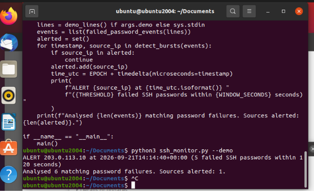

## Testing

Run py ssh_monitor.py --demo in the VS Code Terminal

## Two-minute boundary test

This test checks whether the script handles the exact edge of the two-minute window when counting failed SSH logins from the same IP address.

I changed the last value in `(0, 20, 40, 60, 80)` from `80` to `120`. This made the fifth failure happen exactly 120 seconds after the first. All five failures counted, and the script raised an alert.

I then changed `120` to `121`. I expected no alert because the first failure was now outside the two-minute window, leaving only four failures that counted. The script raised no alert.

**Result:** = Both cases behaved as expected.

## Ubuntu demo test

I ran the SSH monitor on Ubuntu Desktop in VirtualBox using the built-in simulated SSH login failures.

`python3 ~/ssh_monitor.py --demo

**Expected Result** Six matching failed login attempts and one alerted source IP.

**Actual Result** Six matching failed login attempts and one alerted source IP.

This test passed. 

