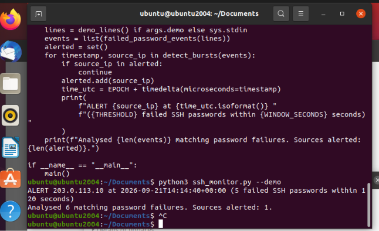
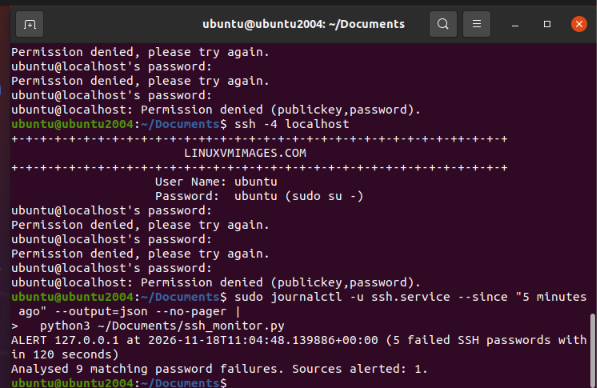
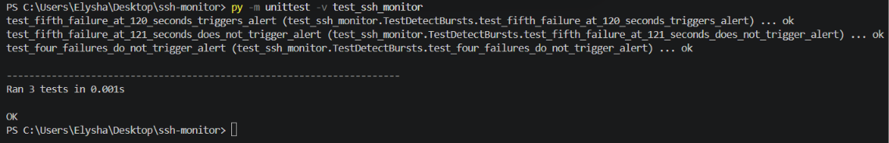

## Project Overview

This python tool analyses Ubuntu SSH logs to identify repeated failed password attempts form the same IP address.It raises a terminal alert when an IP reaches five failures within a rolling 120-second window. 

Repeated failures can indicate password guessing or a legitimate user having difficulty signing in. The alert highlights activity for investigation.

The tool accepts JSON logs from journalctl and includes a demo mode with synthetic login events. It processes the supplied logs and prints alerts alongside a summary of matching failures and the number of sources alerted. 

## Why SSH monitoring matters

SSH provides remote access to systems, making failed login activity useful to monitor. Repeated failures could indicate password guessing, automated login attempts or even a legitimate user having trouble signing in.

Reviewing individual log entries can become time-consuming as activity increases. This tool automates this by grouping failures by source IP address and highlights those that reach five attempts within 120 seconds. This helps an administrator identify activity to investigate.

An alert indictates suspicious activity for review. Failed logins alone do not establish that an account has been compromised. 

## What I learned

Through this project, I practised parsing system logs, validating IP addresses, implementing a sliding time window, writing automated tests and using GitHub Actions to run tests automatically. 

I tested the tool using simulated events and real failed SSH logins on an Ubuntu VM in VirtualBox.

## Testing

Run py ssh_monitor.py --demo in the VS Code Terminal

## Two-minute boundary test

This test checks whether the script handles the exact edge of the two-minute window when counting failed SSH logins from the same IP address.

I changed the last value in `(0, 20, 40, 60, 80)` from `80` to `120`. This made the fifth failure happen exactly 120 seconds after the first. All five failures counted, and the script raised an alert.

I then changed `120` to `121`. I expected no alert because the first failure was now outside the two-minute window, leaving only four failures that counted. The script raised no alert.

**Result:** = Both cases behaved as expected.

## Ubuntu demo test

I ran the SSH monitor on Ubuntu Desktop in VirtualBox using the built-in simulated SSH login failures.

`python3 ~/ssh_monitor.py --demo`

**Expected Result** Six matching failed login attempts and one alerted source IP.

**Actual Result** Six matching failed login attempts and one alerted source IP.

This test passed. 

## Real SSH login failure test

I tested the monitor using real failed SSH logins on Ubuntu Desktop in VirtualBox.

## Method

I connected to the VM from it's own terminal:

`ssh -4 localhost`

I deliberately entered an incorrect password multiple times, reconnecting after SSH ended each connection. 

I generated at least five failed password attempts within two minutes.

I then passed the last five minutes pf SSH journal entries to the monitor:

`sudo journalctl -u ssh.service --since "5 minutes ago" --output=json --no-pager | python3 ~/Documents/ssh_monitor.py`

## Expected result

The monitor should recognise the failed password attempts and raise an alert when the same IP reaches five failures within 120 seconds.

## Actual Result

Matching Password failures : 9
Sources Alerted: 1

The five-minute log range included earlier failed attempts.

The connections used the local IPv4 address, 127.0.0.1

## Outcome

Pass. The monitor processed real Ubuntu SSH logs and flagged a source that reached the detection threshold. 

## Automated detection tests

Run the tests from the project folder:

`python -m unittest -v test_ssh_monitor`

On Windows, I used `py` instead of `python` 

The tests check that:

-No alert is produced at four failed logins.

-A fifth failure exactly 120 seconds after the first triggers an alert. 

-A fifth failure at 121 seconds produces no alert.

-Failures from different IP addresses are counted separately.

**Result = All four tests passed**

## Github Actions

Automated tests run on every push and pull request using Python 3.12 on an Ubuntu runner.

The first workflow run was completed successfully with all eight tests passing.